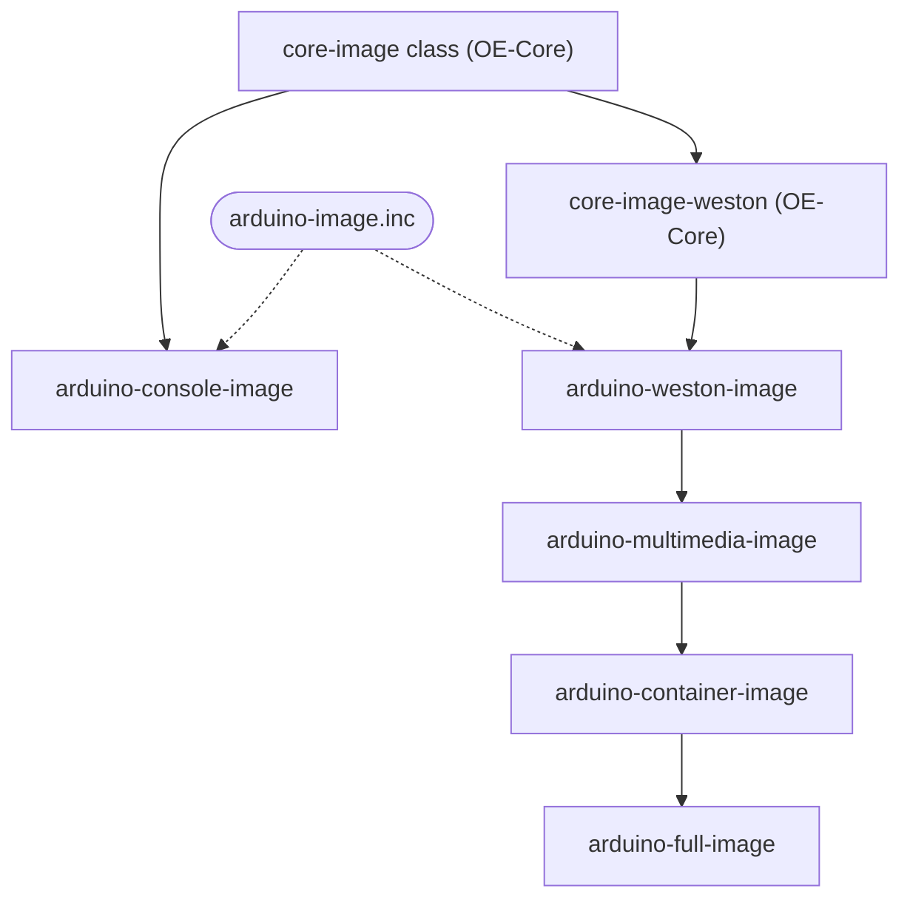

# Developer Guide

## Image Recipes

The image recipes live in `meta-arduino-common/recipes-support/images/` and are shared by all platforms.

Every image applies `arduino-image.inc`, which adds the Arduino baseline: SSH server (dropbear), adbd, USB composite gadget, device tree and overlays, U-Boot scripts, first-boot rootfs expansion, bring-up package groups, `sudo` and the `arduino` user.

| Image | Builds on | Adds |
| --- | --- | --- |
| `arduino-console-image` | `core-image` class (OE-Core) + `arduino-image.inc` | Nothing else: console-only system |
| `arduino-weston-image` | `core-image-weston` (OE-Core) + `arduino-image.inc` | Weston (Wayland compositor) |
| `arduino-multimedia-image` | `arduino-weston-image` | Audio (PipeWire, WirePlumber, ALSA), GStreamer, libcamera, V4L2, GPU/DRM utilities, TensorFlow Lite tools |
| `arduino-container-image` | `arduino-multimedia-image` | Docker and Docker Compose; `arduino` user in the `docker` group |
| `arduino-full-image` | `arduino-container-image` | Arduino App CLI (`arduino-app-cli`) |



Solid arrows point from a base to the recipe that builds on it; dotted arrows show where `arduino-image.inc` is applied.

Notes:

- `arduino-console-image` is not the base of the other images. It and `arduino-weston-image` are siblings that share `arduino-image.inc`.
- Platform-specific packages are added by `.bbappend` files in the BSP layers. `meta-arduino-qcom` adds the Qualcomm multimedia, graphics and AI stack (`arduino-multimedia-image-qcom.inc`) to the multimedia, container and full images; `meta-arduino-nxp` adds `imx-gst1.0-plugin` to the multimedia image.
- A `.bbappend` only applies to the recipe it is named after, not to recipes that `require` that recipe. A new image built on one of these needs its own `.bbappend` to get the platform-specific packages.

## Getting Started [NXP Builds]

> **Warning**: Only the `scarthgap` branch is supported at the moment.

Supported machines:

| Machine |
| --- |
| portenta-x8 |
| portenta-x9 |
| imx8mp-astrial |

For more hardware details and lifecycle status, see [HARDWARE.md](HARDWARE.md).

1. Initialize and sync the Yocto manifest:
   ```bash
   repo init -u https://github.com/nxp-imx/imx-manifest.git -m imx-6.6.52-2.2.0.xml -b imx-linux-scarthgap
   repo sync -j1 --fail-fast
   ```
2. Clone this repository into the `sources` directory created by the manifest:
   ```bash
   cd sources
   git clone https://github.com/Arduino/meta-arduino.git
   cd meta-arduino && git checkout scarthgap
   ```
2. Set up the Docker environment:
   ```bash
   docker run -it -u $(id -u):$(id -g) -v $PWD:/workdir -w /workdir --name yocto-nxp hub.foundries.io/lmp-sdk:95 bash
   ```
4. Configure the build environment:
   ```bash
   MACHINE=portenta-x8 DISTRO=fsl-imx-xwayland EULA=yes source ./imx-setup-release.sh -b bld-xwayland # First time only
   source setup-environment bld-xwayland # Every login, skip first time
   ```
5. Add the layers:
   ```bash
   bitbake-layers add-layer ../sources/meta-arduino/meta-arduino-common
   bitbake-layers add-layer ../sources/meta-arduino/meta-arduino-nxp
   ```
6. Build the image:
   ```bash
   bitbake arduino-console-image
   ```

## Getting Started [QCom Builds]

QCom-based builds use the [kas](https://kas.readthedocs.io/) structure rather than Google Repo.

Supported machines:

| Machine | Board |
| --- | --- |
| imola | UNO Q |
| monza | VentUNO Q |

For more hardware details and lifecycle status, see [HARDWARE.md](HARDWARE.md).

1. Clone this repository and enter it:
   ```bash
   git clone https://github.com/Arduino/meta-arduino.git
   cd meta-arduino
   ```
2. Set up the persistent host directories and cache environment variables:
   ```bash
   # Where kas keeps sources, build output and caches. Change it to put them
   # elsewhere, e.g. a shared disk reused across checkouts.
   export BASE_DIR="$PWD/mnt"
   mkdir -p "$BASE_DIR"/{build,sources,downloads,sstate-cache}

   export KAS_WORK_DIR="$BASE_DIR/sources"
   export KAS_BUILD_DIR="$BASE_DIR/build"
   export DL_DIR="$BASE_DIR/downloads"
   export SSTATE_DIR="$BASE_DIR/sstate-cache"

   # Same kas image as CI (.github/workflows/compile.yml): the released 5.5
   # image lacks ccache, which meta-qcom's CI config requires. Drop this once
   # a kas release newer than 5.5 is out.
   export KAS_CONTAINER_IMAGE="ghcr.io/siemens/kas/kas@sha256:3f3d3257e8d4ca3adfcb2e0025e6da24339fb8d68a6999ca36c37381351582d5"
   ```
3. Download `kas-container` and create the `ci` symlink:
   ```bash
   curl -fsSL https://raw.githubusercontent.com/siemens/kas/master/kas-container -o kas-container
   chmod +x kas-container
   ln -s meta-arduino-qcom/ci ci
   ```
4. Run `kas-container` to open an interactive shell or build (e.g., for Imola / Arduino UNO Q):
   ```bash
   ./kas-container --runtime-args "--memory=48g" shell meta-arduino-qcom/ci/imola.yml
   # or build directly:
   ./kas-container --runtime-args "--memory=48g" build meta-arduino-qcom/ci/imola.yml
   ```
   Or for Monza / VentUNO Q:
   ```bash
   ./kas-container --runtime-args "--memory=48g" shell meta-arduino-qcom/ci/monza.yml
   # or build directly:
   ./kas-container --runtime-args "--memory=48g" build meta-arduino-qcom/ci/monza.yml
   ```

Note: Without `--target`, kas builds the default targets listed in `meta-arduino-qcom/ci/base.yml`: `arduino-console-image`, `arduino-container-image` and `arduino-full-image`. To build a single image, append `--target <image>` to the build command. See [Image Recipes](#image-recipes) for what each image contains.

Note on updating dependencies: The repository includes committed `.lock.yml` files (e.g., `meta-arduino-qcom/ci/imola.lock.yml`) to ensure reproducible builds. If you need to update or regenerate lockfiles after updating base YAML definitions or upstream branch targets, run:
```bash
./kas-container lock meta-arduino-qcom/ci/imola.yml --update
./kas-container lock meta-arduino-qcom/ci/monza.yml --update
```

### Flashing [Imola]

1. Download the output artifact (`arduino-container-image-imola.rootfs.qcomflash.tar.gz`) from the Yocto deploy directory, extract it, and `cd` into the extracted folder.
2. Locally on your host PC, use `qdl` from inside the extracted archive:
   ```bash
   qdl --storage emmc --debug prog_firehose_ddr.elf rawprogram0.xml patch0.xml
   ```

### Flashing [Monza]

1. Download the output artifact (`arduino-container-image-monza.rootfs.qcomflash.tar.gz`) from the Yocto deploy directory, extract it, and `cd` into the extracted folder.
2. Locally on your host PC, use `qdl` from inside the extracted archive:
   ```bash
   qdl --storage spinor --debug prog_firehose_ddr.elf sail_nor/rawprogram*.xml sail_nor/patch*.xml --allow-missing
   qdl --storage emmc --debug prog_firehose_ddr.elf rawprogram1.xml patch1.xml
   qdl --storage emmc --debug prog_firehose_ddr.elf rawprogram0.xml patch0.xml
   ```

## Getting Started [LmP Builds]

> **Warning**: Only the `scarthgap` branch is supported at the moment.

Supported machines:

| Machine |
| --- |
| portenta-x8 |
| raspberrypi4-64 |

For more hardware details and lifecycle status, see [HARDWARE.md](HARDWARE.md).

1. Initialize and sync the Yocto manifest:
   ```bash
   repo init -u https://github.com/arduino/lmp-manifest.git -m arduino.xml -b main
   repo sync -j1 --fail-fast
   ```
2. Set up the Docker environment:
   ```bash
   docker run -it -u $(id -u):$(id -g) -v $PWD:/workdir -w /workdir --name yocto-lmp hub.foundries.io/lmp-sdk:95 bash
   ```

### Build mfgtools

1. Configure the build environment for `mfgtool-files`:
   ```bash
   DISTRO=lmp-mfgtool MACHINE=portenta-x8 . setup-environment
   echo "ACCEPT_FSL_EULA = \"1\"" >> conf/local.conf
   echo "MFGTOOL_FLASH_IMAGE = \"lmp-factory-image\"" >> conf/local.conf
   ```
2. Build the `mfgtool-files`:
   ```bash
   bitbake mfgtool-files
   ```

### Build the lmp factory image

1. Configure the build environment for the image:
   ```bash
   DISTRO=lmp-xwayland MACHINE=portenta-x8 . setup-environment
   echo "ACCEPT_FSL_EULA = \"1\"" >> conf/local.conf
   ```
2. Build the image:
   ```bash
   bitbake lmp-factory-image
   ```

### Build the lmp devel image

1. Configure the build environment for the image:
   ```bash
   DISTRO=lmp-base-xwayland MACHINE=portenta-x8 . setup-environment
   echo "ACCEPT_FSL_EULA = \"1\"" >> conf/local.conf
   ```
2. Build the image:
   ```bash
   bitbake lmp-devel-arduino-image
   ```

## How-To: Add Custom Devicetree Overlays and Kernel Configurations

> **Best Practice Note**: The examples below demonstrate modifications directly inside the layers provided in this repository. For project-specific customizations or proprietary add-ons, create your own separate Yocto layer and use `.bbappend` files rather than modifying these base layers directly.

### 1. Adding a Devicetree Overlay

1. **Add the overlay file**:
   Place your overlay source file (`<overlay_name>.dts`) in the appropriate machine overlays directory:
   - **NXP / LmP**: `meta-arduino-nxp/recipes-bsp/device-tree/arduino-device-tree/<machine>/overlays/<overlay_name>.dts`
   - **QCom**: `meta-arduino-qcom/recipes-bsp/device-tree/arduino-device-tree/<machine>/overlays/<overlay_name>.dts`

2. **Register the overlay for compilation**:
   Append the overlay to `DTB_OVERLAYS` in `arduino-device-tree.inc` (or in your custom `arduino-device-tree.bbappend`):
   ```bitbake
   DTB_OVERLAYS:append:<machine> = " \
       file://<machine>/overlays/<overlay_name>.dts \
   "
   ```

### 2. Adding Kernel Modules and Configuration Fragments (`.cfg`)

Rather than editing the default `defconfig` directly, Yocto best practice is to supply a configuration fragment (`.cfg`):

- **NXP builds (`linux-imx`)**:
  Keep the base `defconfig` intact. Place your custom `.cfg` in your layer's files directory and append it to `SRC_URI` in a `linux-imx_%.bbappend`:
  ```bitbake
  FILESEXTRAPATHS:prepend := "${THISDIR}/${PN}:"
  SRC_URI:append:<machine> = " file://my-custom-feature.cfg"
  ```
- **LmP builds (`linux-lmp-fslc-imx`)**:
  Add required kernel options to the machine-specific configuration fragment at `meta-arduino-lmp/recipes-kernel/linux/linux-lmp-fslc-imx/<machine>/<machine>.cfg`, or append a custom `.cfg` via a `linux-lmp-fslc-imx_%.bbappend`.
- **QCom builds (`linux-arduino` / `linux-qcom-next`)**:
  Add options directly to `meta-arduino-qcom/recipes-kernel/linux/linux-arduino/<machine>.cfg` (or `linux-qcom-next/<machine>.cfg`), or append a custom `.cfg` via `SRC_URI` in a `linux-arduino_%.bbappend` or `linux-qcom-next_%.bbappend`.
